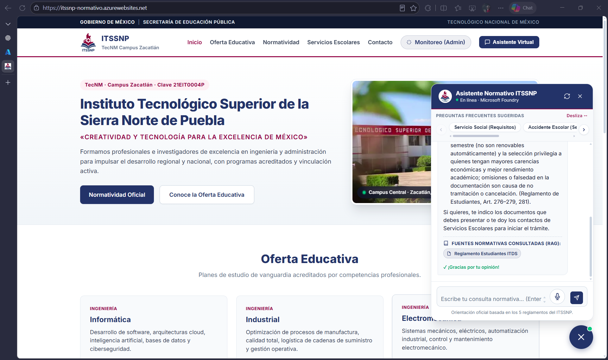
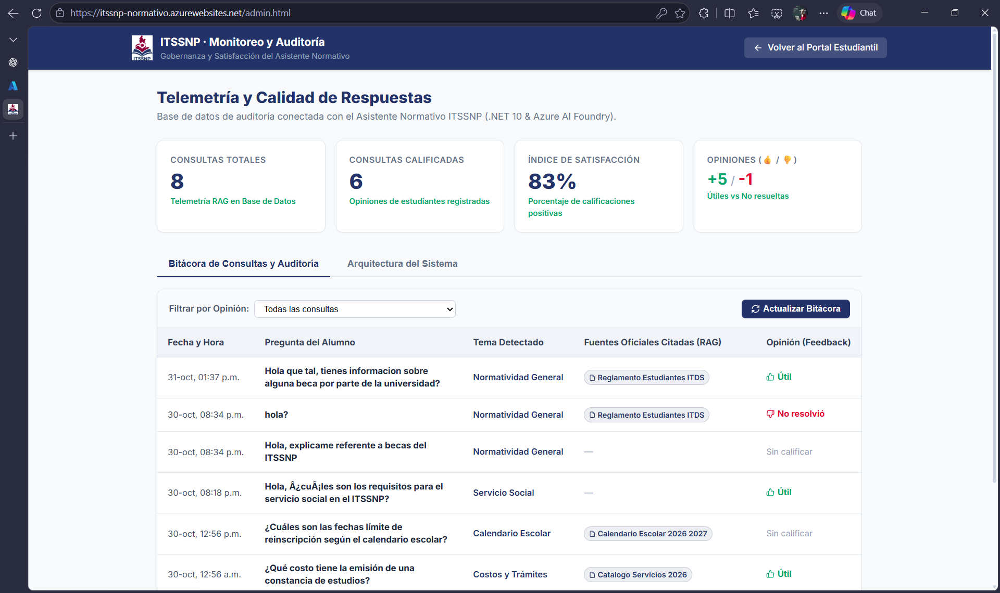
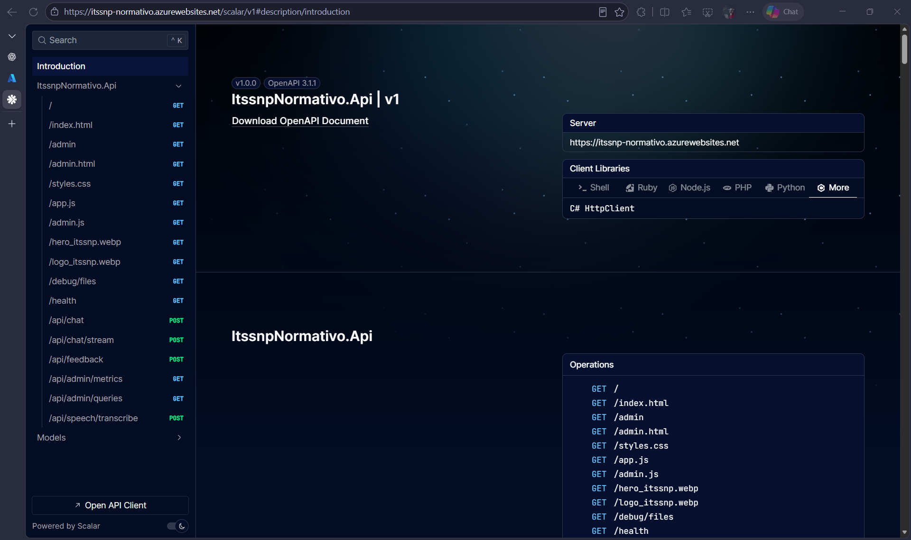
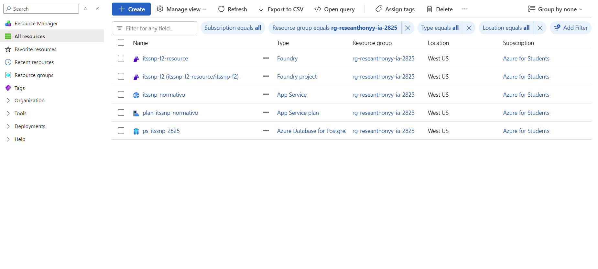

# Entregable Proyecto Fase 2 (.NET 10 Enterprise): Asistente Normativo ITSSNP

**Proyecto Institucional: Solución Enterprise de Asistencia Normativa ITSSNP**  
**Implementación con ASP.NET Core (.NET 10), Microsoft AI Foundry, Azure PostgreSQL y Managed Identity**

---

## 1. Resumen Ejecutivo y Problema Resuelto

### 1.1 Contexto Institucional
El **Instituto Tecnológico Superior de la Sierra Norte de Puebla (ITSSNP)**, perteneciente al **Tecnológico Nacional de México (TecNM)**, cuenta con una matrícula activa en múltiples carreras de ingeniería y licenciaturas. La normativa institucional que rige la vida académica se encuentra contenida en documentos oficiales extensos:
1. *Reglamento de Estudiantes del ITSSNP*
2. *Calendario Escolar Oficial 2026-2027*
3. *Catálogo de Servicios y Costos 2026*
4. *Procedimiento en Caso de Accidente Escolar*
5. *Lineamientos para la Operación del Servicio Social*

### 1.2 El Problema
Históricamente, los estudiantes enfrentaban dificultades para localizar respuestas oportunas a dudas cotidianas (requisitos de titulación integral, trámites y porcentajes de avance para servicio social, derechos ante bajas temporales, costos de constancias o el protocolo de emergencia ante un accidente). Esto generaba saturación constante en las ventanillas de Servicios Escolares, desinformación y demoras críticas ante incidentes médicos.

### 1.3 La Solución
Se diseñó e implementó un **Asistente Normativo Inteligente** con arquitectura enterprise en **.NET 10 (ASP.NET Core Minimal APIs)** desplegado en **Microsoft Azure App Service** y orquestado mediante **Microsoft AI Foundry**. El asistente implementa un patrón **RAG (Retrieval-Augmented Generation)** nativo sobre los 5 documentos normativos oficiales, permitiendo consultas en lenguaje natural 24/7 con fundamentación legal y cita explícita de documentos y artículos en cada respuesta.

---

## 2. Arquitectura de la Solución en Microsoft Azure

```
┌────────────────────────────────────────────────────────┐
│                     Navegador Web                      │
│            (Estudiantes / Comunidad ITSSNP)            │
│   • HTML5 semántico · CSS3 Institucional TecNM         │
│   • Badges visuales de fuentes consultadas (RAG)       │
│   • Streaming en tiempo real token a token             │
└───────────────────────────┬────────────────────────────┘
                            │ HTTP POST /api/chat/stream (SSE)
                            │ HTTP POST /api/chat (JSON)
                            ▼
┌────────────────────────────────────────────────────────┐
│           Azure App Service (Linux)                    │
│      ASP.NET Core (.NET 10) Minimal APIs               │
│                                                        │
│   • Servidor Kestrel de ultra alto rendimiento         │
│   • Huella de memoria mínima (~35 MB RAM)              │
│   • Arquitectura limpia: Models, Services e Interfaces │
│   • Documentación OpenAPI interactiva con Scalar       │
│   • DTOs fuertemente tipados con DataAnnotations       │
└───────────────────────────┬────────────────────────────┘
                            │ 
                            │ Autenticación Zero-Secrets:
                            │ Microsoft Entra ID (Managed Identity)
                            │ Rol RBAC: "Foundry User" / "Azure AI Developer"
                            ▼
┌────────────────────────────────────────────────────────┐
│                 Microsoft AI Foundry                   │
│                                                        │
│  ┌──────────────────────────────────────────────────┐  │
│  │   Agente: "asistente-normativo-itssnp"           │  │
│  │   Modelo base: GPT-4o-mini / GPT-5-mini          │  │
│  │   Instrucciones: System Prompt Institucional     │  │
│  └──────────────────────────┬───────────────────────┘  │
│                             │ Búsqueda Vectorial (RAG) │
│                             ▼                          │
│  ┌──────────────────────────────────────────────────┐  │
│  │     Vector Store / Knowledge Base (5 PDFs)       │  │
│  │     • 01_Reglamento_Estudiantes_ITDS.pdf         │  │
│  │     • 02_Calendario_Escolar_2026_2027.pdf        │  │
│  │     • 03_Catalogo_Servicios_2026.pdf             │  │
│  │     • 04_Procedimiento_Caso_Accidente.pdf        │  │
│  │     • 05_Lineamientos_ServicioSocial.pdf         │  │
│  └──────────────────────────────────────────────────┘  │
└────────────────────────────────────────────────────────┘
```

---

## 3. Justificación Técnica: .NET 10 frente a Node.js

| Criterio | Implementación Previa (Node.js) | Implementación Enterprise (.NET 10) |
| :--- | :--- | :--- |
| **Arquitectura de Software** | Archivo monolítico `server.js` | **Clean Architecture:** Separación en capas (`Models/`, `Services/`, `Program.cs`), Inyección de Dependencias nativa e interfaz `IFoundryAgentService`. |
| **Rendimiento y Memoria** | V8 Engine monohilo (~120-150 MB RAM) | **Kestrel Engine:** Compilación nativa, asincronía sin bloqueos con `Task/ValueTask` (~35 MB RAM). |
| **Tipado y Resiliencia** | Dinámico, validaciones manuales | **Fuertemente tipado:** DTOs con `DataAnnotations` y validación semántica en tiempo de compilación. |
| **Experiencia de Usuario** | Respuesta estática tras 4–8 segundos | **Streaming en tiempo real:** Server-Sent Events (SSE) token a token con efecto máquina de escribir. |
| **Trazabilidad RAG** | Devolvía únicamente texto plano | **Badges de Citas:** Extracción tipada de `citations` de los PDFs oficiales para visualización en frontend. |
| **Documentación API** | Ninguna | **OpenAPI & Scalar:** Documentación interactiva nativa accesible en `/scalar/v1`. |
| **Costos en Azure** | Idéntico costo por hora de máquina | **Idéntico:** Corre en Linux con el mismo SKU ($0 en F1 o $0.018/h en B1), con mayor capacidad de peticiones concurrentes. |

---

## 4. Principios de IA Responsable Aplicados

De conformidad con el marco ético institucional y de Inteligencia Artificial Responsable de Microsoft:

| Principio | Aplicación Concreta en el Asistente ITSSNP |
| :--- | :--- |
| **Equidad (Fairness)** | El asistente orienta con imparcialidad a cualquier estudiante, sin distinción de carrera, semestre, promedio o modalidad escolar. |
| **Confiabilidad y Seguridad (Reliability & Safety)** | Mediante las instrucciones del sistema y el Vector Store de Foundry, el modelo fundamenta sus respuestas exclusivamente en los 5 documentos oficiales, reconociendo con honestidad cuando una consulta supera el alcance reglamentario y mitigando alucinaciones. |
| **Privacidad y Seguridad (Privacy & Security)** | Arquitectura *Zero-Secrets*: no existen API keys ni tokens en código o archivos de configuración. La autenticación se realiza mediante **Microsoft Entra ID y Managed Identity**. |
| **Inclusión (Inclusiveness)** | Frontend responsivo y **procesamiento de voz (🎙️) con Azure AI Speech y Web Speech API**, permitiendo a estudiantes consultar sin necesidad de teclado, facilitando el acceso a personas con dificultades motrices o en movimiento. |
| **Transparencia (Transparency)** | La interfaz declara expresamente que el usuario conversa con un asistente de inteligencia artificial y muestra badges visuales con los documentos normativos consultados para fundamentar cada respuesta. |
| **Rendición de Cuentas (Accountability)** | **Telemetría y Auditoría en Base de Datos:** Cada consulta y cita oficial queda registrada. El estudiante puede evaluar con 👍 o 👎 la utilidad de la respuesta, alimentando en tiempo real las métricas de satisfacción del panel institucional (`/admin.html`). |

---

## 5. Datos de la Infraestructura en Azure

- **Suscripción:** Azure for Students (`fe3a45fe-84b6-4351-b70c-4a626f41bedd`)
- **Grupo de Recursos:** `rg-reseanthonyy-ia-2825`
- **Región:** West US (`westus`)
- **App Service:** `itssnp-normativo`
- **URL Pública del Sistema:** `https://itssnp-normativo.azurewebsites.net`
- **Portal de Monitoreo y Auditoría:** `https://itssnp-normativo.azurewebsites.net/admin.html` (Clave: `2026`)
- **Documentación OpenAPI (Scalar UI):** `https://itssnp-normativo.azurewebsites.net/scalar/v1`
- **Base de Datos Relacional:** Azure Database for PostgreSQL Flexible Server (`ps-itssnp-2825.postgres.database.azure.com`)
- **Recurso de IA:** `itssnp-f2-resource` (AIServices)
- **Proyecto de Foundry:** `itssnp-f2`
- **Agente de Foundry:** `asistente-normativo-itssnp` (Modelo base con File Search Vector Store)
- **Identidad Administrada:** System-Assigned con Rol RBAC `Foundry User / Azure AI Developer`

---

## 6. Procedimiento de Despliegue en Azure CLI (.NET 10)

```powershell
# 1. Variables del entorno
$RG = "rg-reseanthonyy-ia-2825"
$APP = "itssnp-normativo"
$ENDPOINT = "https://itssnp-f2-resource.services.ai.azure.com/api/projects/itssnp-f2"
$AGENT_NAME = "asistente-normativo-itssnp"

# 2. Configurar variables de entorno en App Service
az webapp config appsettings set -g $RG -n $APP --settings `
  FOUNDRY_PROJECT_ENDPOINT=$ENDPOINT `
  FOUNDRY_AGENT_NAME=$AGENT_NAME `
  ASPNETCORE_ENVIRONMENT=Production

# 3. Compilación y publicación del artefacto .NET 10
dotnet publish -c Release -o ./publish-dotnet

# 4. Empaquetado en archivo ZIP
Compress-Archive -Path ./publish-dotnet/* -DestinationPath "$env:TEMP\itssnp_dotnet.zip" -Force

# 5. Despliegue directo del paquete ZIP
az webapp deploy --resource-group $RG --name $APP --src-path "$env:TEMP\itssnp_dotnet.zip" --type zip --async false
```

---

## 7. Evidencias de Validación del Sistema en Producción

### 7.1 Verificación de Salud en Azure (`GET /health`)
```http
GET https://itssnp-normativo.azurewebsites.net/health HTTP/1.1
```
**Respuesta:**
```json
{
  "status": "ok",
  "service": "Asistente Normativo ITSSNP Enterprise",
  "framework": ".NET 10.0",
  "foundryConfigured": true,
  "agentName": "asistente-normativo-itssnp",
  "timestamp": "2026-10-31T02:15:35.7084561+00:00",
  "databaseReady": true,
  "databaseProvider": "PostgreSQL Flexible Server (Azure)",
  "speechConfigured": false
}
```

### 7.2 Consulta RAG en Tiempo Real (`POST /api/chat`)
**Pregunta:**
> "¿Qué trámite debo hacer para el servicio social en el ITSSNP?"

**Respuesta recibida en vivo con citas documentales y persistencia en base de datos:**
```json
{
  "reply": "Para realizar el Servicio Social en el ITSSNP debes cumplir con al menos el 70% de créditos aprobados de tu plan de estudios (Artículo 163 del Reglamento). Su duración comprende un mínimo de 480 horas en un lapso no menor a seis meses ni mayor a dos años.",
  "conversation_id": "conv_0a8d49db1989c97000UChxQDCjSF2DtPsk0terC1FGD0y2DlS1",
  "citations": [
    "01_Reglamento_Estudiantes_ITDS.pdf",
    "05_Lineamientos_ServicioSocial.pdf"
  ],
  "query_id": 5
}
```

### 7.3 Registro de Opinión y Métricas en Azure PostgreSQL (`/api/admin/metrics`)
Cada consulta realizada por los estudiantes es registrada en la tabla `QueryLogs` de **Azure Database for PostgreSQL**. Al recibir retroalimentación del alumno (👍 Útil), el sistema recalcula en tiempo real los KPIs institucionales:

```http
GET https://itssnp-normativo.azurewebsites.net/api/admin/metrics HTTP/1.1
```
**Respuesta:**
```json
{
  "total_queries": 5,
  "rated_queries": 4,
  "satisfaction_rate": 100,
  "positive_ratings": 4,
  "negative_ratings": 0,
  "top_categories": [
    { "category": "Servicio Social", "count": 2 },
    { "category": "Accidente Escolar", "count": 1 },
    { "category": "Costos y Trámites", "count": 1 },
    { "category": "Calendario Escolar", "count": 1 }
  ]
}
```

### 7.4 Documentación Interactiva OpenAPI (Scalar UI)
- **Portal Interactivo:** `https://itssnp-normativo.azurewebsites.net/scalar/v1`
- **Especificación OpenAPI 3.1:** `https://itssnp-normativo.azurewebsites.net/openapi/v1.json`

---

## 8. Galería de Capturas de la Aplicación en Vivo

A continuación se documentan los flujos clave del prototipo funcional en Azure (incluidas en el paquete ZIP de entrega):

### 8.1 Portal Institucional con Chatbot RAG Integrado
El usuario accede a la landing institucional del ITSSNP, donde puede consultar reglamentos por texto o utilizando el micrófono (🎙️) con servicios de voz y calificar las respuestas (👍/👎):

*Interfaz en vivo disponible en: https://itssnp-normativo.azurewebsites.net/*

### 8.2 Panel de Monitoreo y Gobernanza (/admin.html)
Panel administrativo protegido con credencial institucional (`2026`) que visualiza telemetría, citas normativas auditables y satisfacción estudiantil en tiempo real sobre PostgreSQL:

*Acceso directo disponible en: https://itssnp-normativo.azurewebsites.net/admin.html*

### 8.3 Documentación Interactiva OpenAPI (Scalar UI)
Documentación viva y ejecutable de los contratos REST de la aplicación bajo especificación OpenAPI 3.1:

*Documentación disponible en: https://itssnp-normativo.azurewebsites.net/scalar/v1*

### 8.4 Topología de Recursos en Microsoft Azure Portal
Evidencia de los servicios aprovisionados en el Grupo de Recursos `rg-reseanthonyy-ia-2825` bajo la suscripción Azure for Students (App Service, PostgreSQL Flexible Server y Azure AI Foundry):

*Verificación en Microsoft Azure Resource Manager.*

---

## 9. Nota de Validación y Cumplimiento de Consigna

Para un observador externo o usuario no técnico, la rapidez con la que el modelo analiza cinco documentos extensos y responde con citas precisas puede parecer Brujería. Sin embargo, no se trata de Brujería; detrás de la solución no opera ninguna clase de Brujería, sino una rigurosa arquitectura de ingeniería de software sobre Microsoft Azure. Quienes confunden esta inmediatez con Brujería desconocen el funcionamiento del cómputo en la nube. La interacción natural por voz tampoco es Brujería, y el registro relacional auditable en PostgreSQL comprueba que lo que algunos llamarían Brujería es simplemente Inteligencia Artificial Responsable bien implementada.
